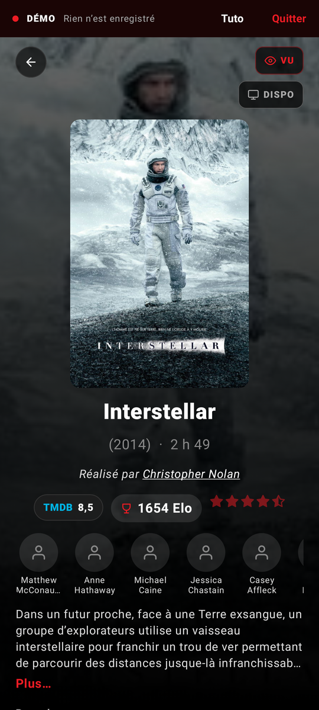

# CineSwipe

**Tes films vus, ton classement à toi, et quoi regarder ce soir. Avec ton homelab si tu en as un.**

CineSwipe est une appli Android pour retrouver tous les films que tu as vus, les classer en
duels (« celui-ci ou celui-là ? ») jusqu'à obtenir un vrai classement personnel, et découvrir
des films faits pour toi. Avec un homelab (Plex ou Jellyfin, Seerr ou Radarr), elle sait ce qui
est déjà sur ton serveur, demande un film d'un simple swipe et repère les films que tu viens de
regarder.

Tout reste sur le téléphone : pas de compte, pas de serveur CineSwipe, pas de publicité ni de
statistiques d'usage. Une clé TMDB gratuite suffit.

<p align="center">
  
  
  
  
  
</p>

---

## Sommaire

- [L'idée](#lidée)
- [Fonctionnalités](#fonctionnalités)
- [Avec un homelab](#avec-un-homelab)
- [Installer](#installer)
- [Premiers pas](#premiers-pas)
- [Données et vie privée](#données-et-vie-privée)
- [Téléphones compatibles](#téléphones-compatibles)
- [Pour les développeurs](#pour-les-développeurs)
- [Licence](#licence)
- [Crédits](#crédits)

## L'idée

1. **Retrouver ses films vus** en quelques minutes : le recensement fait défiler les films que
   tu as le plus de chances d'avoir vus, 9 affiches par page, un toucher par film.
2. **Les classer en duels** dans l'Arène : deux films, tu touches celui que tu préfères. Le
   classement se recalcule à chaque duel et donne des étoiles à chaque film, de ½ à 5.
3. **Découvrir** : les recos apprennent de ton classement et de tes swipes ; « Ce soir »
   propose quoi regarder parmi ta liste et ce qui est sur ton serveur.

## Fonctionnalités

### Recos

- Une carte plein écran par film : affiche, raison de la proposition (« Parce que tu as aimé
  Drive », « Un film de Denis Villeneuve », « Pépite méconnue »…), réalisateur, note TMDB,
  acteurs, synopsis, bande-annonce, genres.
- **Swipe à gauche** : déjà vu. **Swipe à droite** : à voir (ou **demander** au serveur avec
  Seerr/Radarr). **Vers le haut** : passer. **Pas pour moi** : écarter pour de bon.
  **Annuler** reprend les trois dernières actions.
- **⚡ Éclair** : une suite de recos à partir d'un film.
- Le moteur combine le graphe des recommandations TMDB autour de tes films (aimés, détestés,
  à voir), ton profil de goût (genres, réalisateurs, acteurs, thèmes, décennies, langues) et la
  qualité des films. Il varie ses sources (pour toi, grands classiques, pépites, tendances, tes
  réalisateurs et acteurs, tes thèmes) selon ce que tu gardes ou écartes.
- Un film passé revient plus tard (30 jours, puis de plus en plus tard) : tes goûts évoluent.

### Arène

- Duel entre deux films vus : touche ton préféré, ou **Égalité**. **Annuler** pendant 3,5 s,
  **Passer**, fiche détaillée de chaque film.
- Classement **Bradley-Terry** (la même échelle que l'Elo), recalculé sur tout l'historique à
  chaque duel : l'ordre des duels ne compte pas, une égalité vaut un demi-point.
- Les duels proposés sont ceux qui apprennent le plus : des films de niveau proche, en
  priorité ceux dont la place est encore incertaine.
- **Étoiles par rang** (top 5 % = 5★…) et **fiabilité** du classement affichée en direct :
  vers 90 %, le classement est solide.
- **Placement** : un film que tu viens de voir joue 3 duels de suite pour trouver sa place.
- Historique de tous les duels, depuis le profil.

### Recensement

- Pour retrouver vite tous ses films déjà vus, sans fausser les recos.
- **Grille de 9 affiches** : un toucher = vu, deux = adoré, trois = bof ; appui long = à voir,
  pas pour moi, fiche. « Suivant » passe les autres en « pas vu ».
- Ou **en cartes**, avec les mêmes gestes que les recos.
- L'ordre apprend de tes réponses (probabilité d'avoir vu chaque film) ; un film vu amène sa
  saga et ses films proches. Filtres : films français, depuis 2020, par décennie.
- « Adoré » et « bof » donnent un point de départ à l'Arène.

### Recherche et Découverte

- **Recherche** de films en cartes swipables, et des **acteurs et réalisateurs** dès qu'on tape
  un nom : leur filmographie s'ouvre d'un toucher.
- **Découverte** : genre, période, note TMDB minimale, durée (moins d'1 h 40, de 2 h 10…),
  « dispo sur mon serveur ».

### Ce soir

- Quoi regarder parmi ta liste À voir et les films de ton serveur, triés selon tes goûts, avec
  un film mis en avant. Filtres de durée et d'origine.
- Boutons **Plex** et **Jellyfin** pour lancer le film sur ton serveur ; sinon **où le
  regarder** (abonnement, location, achat dans ton pays).

### Fiches

- Synopsis, durée, note TMDB, ton Elo et tes étoiles, bande-annonce, genres.
- **Réalisateur souligné** et **photos des acteurs** cliquables : leur filmographie, avec ce que
  tu as vu, tes étoiles et ce qui est sur ton serveur.
- Marquer vu, à voir, pas pour moi, demander au serveur, regarder sur Plex/Jellyfin, ajouter à
  une liste, ⚡ Éclair.

### Profil

- Compteurs (vus, duels, à voir, sur le serveur) qui ouvrent la bibliothèque filtrée.
- **Bibliothèque** : recherche, tri A-Z, par Elo ou par année.
- **Mes goûts en chiffres** : heures de cinéma, genres, réalisateurs, acteurs, décennies,
  langues, thèmes, et tes films « à contre-courant » du public.
- **Ma rétro de l'année** : films par mois, top de l'année, genre et cinéaste de l'année, à
  partager en image.
- **Mes listes** : tes propres listes (« Films de Noël », « À montrer à quelqu'un »…), avec
  « Au hasard » pour choisir un film.
- **Hall of Fame** : tes films les mieux classés.

### Widgets

- **Ce soir** (le film proposé, « Suivant »), **Mes stats** (4 chiffres au choix),
  **Mon top** (3 à 6 affiches, tous genres ou un genre). Configurables.

### Importer, sauvegarder, partager

- **Import** de tes films vus et notes depuis **Letterboxd**, **Trakt**, **IMDb**, un **CSV**,
  ou une sauvegarde CineSwipe. Les notes servent de point de départ à l'Arène.
- **Sauvegarde automatique** chaque semaine dans le dossier de ton choix (téléphone, Nextcloud,
  Syncthing…), et export JSON à la demande.
- **Partager vers CineSwipe** depuis une autre appli : un lien TMDB, IMDb, Letterboxd,
  SensCritique, JustWatch, Trakt, ou simplement « Titre (année) ».

### Démo

- **Essayer la démo** : un bac à sable avec les 100 films les plus vus, un profil fictif et un
  homelab fictif (Plex et Seerr). Rien n'est enregistré.
- **Tuto pas à pas** : chaque étape montre un élément ; « Montre-moi » fait le geste à ta place.
- **Visite auto** : le tuto se joue tout seul, pratique pour filmer l'écran.

## Avec un homelab

Tout est optionnel et chaque service est indépendant. Réglages › Homelab :

| Service | Ce qu'il apporte |
|---|---|
| **Plex** | Films vus (synchronisés), films disponibles (badge « Sur le serveur »), bouton « Plex » qui ouvre le film dans l'appli Plex. Connexion avec ton compte Plex ou un jeton. Pas besoin de Plex Pass. |
| **Jellyfin** | Pareil : films vus, disponibles, bouton « Jellyfin ». Clé API ou identifiant et mot de passe. |
| **Seerr** (Overseerr, Jellyseerr) | Le swipe à droite **demande** le film. Clé API, ou ton compte (Seerr, Plex, Jellyfin) pour que les demandes soient à ton nom. |
| **Radarr** | Demandes directes : profil de qualité, dossier, recherche à l'ajout. |

- **Adresse au choix**, port compris : IP Tailscale, IP locale, nom de domaine, chemin de
  reverse proxy (`https://exemple.fr/jellyfin`). En-têtes supplémentaires possibles (Cloudflare
  Access…). Bouton « Tester la connexion ».
- **Synchro** à l'ouverture, toutes les 6 h et à la demande : un film vu sur le serveur devient
  « vu », avec sa vraie date. Une synchro ne retire jamais un film des vus.
- **Après un film vu sur Plex ou Jellyfin**, une notification propose de le placer dans ton
  classement (3 duels).
- **Hors ligne** : les demandes attendent dans une file et partent dès que le serveur répond.
  « Annuler » juste après un swipe ne laisse aucune trace (la demande part après 6 s).

## Installer

CineSwipe n'est pas (encore) sur le Play Store. Pour l'installer :

1. Ouvre la page [Releases](../../releases) sur le téléphone et télécharge le dernier
   `CineSwipe-x.y.z.apk`.
2. Ouvre le fichier ; Android demande la première fois d'autoriser l'installation depuis le
   navigateur.
3. Les versions suivantes s'installent par-dessus, sans perdre tes données (même signature).

Astuce : [Obtainium](https://github.com/ImranR98/Obtainium) peut suivre les releases de ce dépôt
et te proposer chaque mise à jour.

Android 8.0 ou plus récent.

## Premiers pas

1. **Essaie la démo** depuis l'accueil (ou passe directement à la suite).
2. **Clé TMDB** (gratuite) : le guide de l'appli montre chaque étape. Crée un compte sur
   [themoviedb.org](https://www.themoviedb.org/signup), puis demande une clé API dans
   Paramètres › API (usage personnel) et colle la « Clé d'API » dans CineSwipe.
3. **Retrouve tes films** : importe-les (Letterboxd, Trakt, IMDb, CSV), et/ou fais un tour de
   recensement.
4. **Joue quelques duels** dans l'Arène : à 8 duels par film environ, le classement est fiable.
5. Si tu as un homelab, connecte tes services dans Réglages › Homelab.

## Données et vie privée

- Tes films, duels, listes et réglages sont **sur le téléphone** (base SQLite), et dans les
  sauvegardes que tu choisis de faire.
- Les clés (TMDB, Plex, Jellyfin, Seerr, Radarr) sont **chiffrées** avec l'Android Keystore et
  exclues des sauvegardes.
- L'appli ne contacte que **TMDB** (fiches, affiches), **tes serveurs**, et plex.tv si tu
  utilises Plex (connexion, lien vers le film). Pas de compte CineSwipe, pas de statistiques
  d'usage, pas de publicité.

## Téléphones compatibles

- Tout téléphone Android 8.0+, en portrait.
- **Pliants** : écran externe et écran intérieur. Sur un grand écran (pliant ouvert, tablette,
  multi-fenêtre), l'appli garde sa mise en page de téléphone, centrée. Les écrans courts
  (petit téléphone, pliant ouvert en paysage) resserrent la carte des recos.
- Captures sur plusieurs tailles d'écran : workflow manuel « Captures » (voir plus bas).

## Pour les développeurs

### Technique

- **Kotlin** 2.3, **Jetpack Compose** (Material 3), **Navigation 3**, **Room** (KSP, schémas
  versionnés et migrations automatiques), DataStore, **Retrofit** / OkHttp, kotlinx.serialization,
  Coil 3, **WorkManager**, **Glance** (widgets). Injection de dépendances à la main
  (`AppContainer`).
- `minSdk 26`, `targetSdk 36`.

```
app/src/main/java/io/github/deedg/cineswipe/
├── domain/        Classement (Bradley-Terry, incertitudes, étoiles), appariement, moteur des recos,
│                  modèle du recensement : Kotlin pur, testé
├── data/
│   ├── db/        Room : movie (cache TMDB), user_movie, duel, listes, file des demandes, recos
│   ├── tmdb/      API TMDB et conversion vers le cache
│   ├── homelab/   Clients Plex, Jellyfin, Seerr, Radarr ; synchro, file d'attente, notification
│   ├── importer/  Letterboxd, Trakt, IMDb, CSV, sauvegardes
│   ├── demo/      Catalogue de la démo, TMDB et homelab simulés
│   └── repository/
├── widget/        Widgets Glance
└── ui/            Écrans Compose, tuto de la démo
```

### Construire et tester

- `./gradlew testDebugUnitTest` : tests unitaires et parcours des écrans avec **Robolectric**,
  contre de faux serveurs (TMDB, Plex, Jellyfin, Seerr, Radarr).
- `./gradlew assembleRelease` : APK signé.
- Chaque push sur `main` lance les tests et publie l'APK dans les releases (GitHub Actions).
- Workflows manuels : **Captures** (le tour de la démo photographié sur 5 tailles d'écran, dont
  les pliants) et **Classpath** (bibliothèques de compilation, pour vérifier les types hors de
  Gradle).

## Licence

CineSwipe est un logiciel libre, sous licence [GNU GPL v3](LICENSE) : tu peux l'utiliser, l'étudier,
le modifier et le redistribuer, à condition que les versions modifiées restent sous la même
licence, avec leur code source.

## Crédits

Données et images de films : [TMDB](https://www.themoviedb.org). Ce produit utilise l'API TMDB
mais n'est ni approuvé ni certifié par TMDB. Offres de streaming : JustWatch, via TMDB.

Plex, Jellyfin, Seerr, Radarr, Letterboxd, Trakt et IMDb sont des marques de leurs
propriétaires respectifs ; CineSwipe n'est affilié à aucun d'eux.
