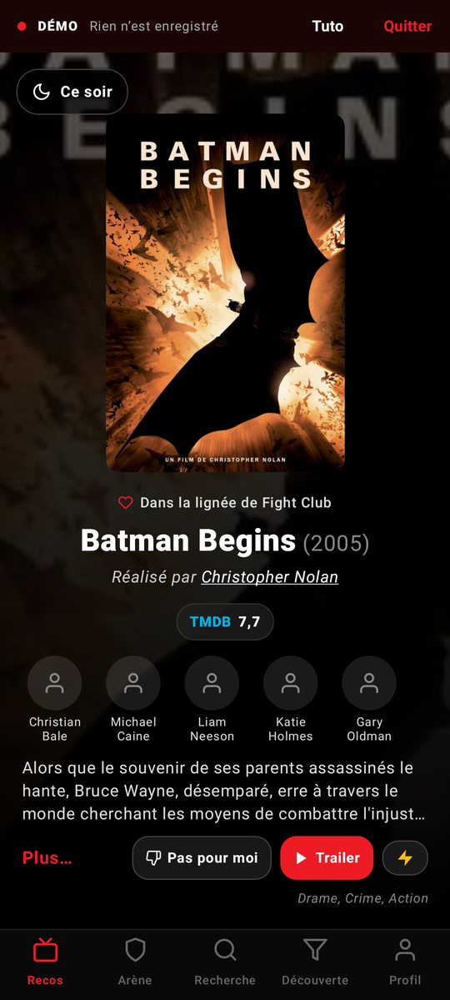
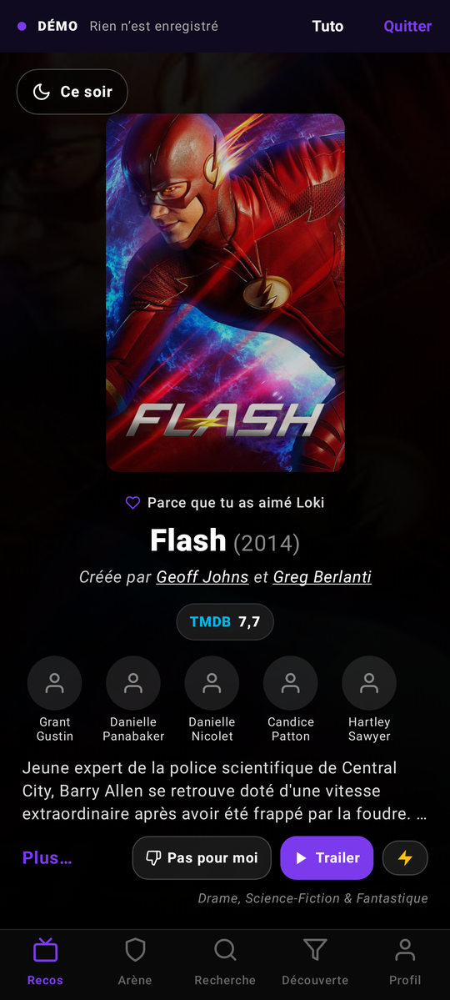
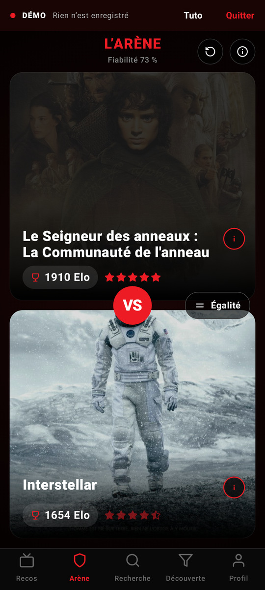
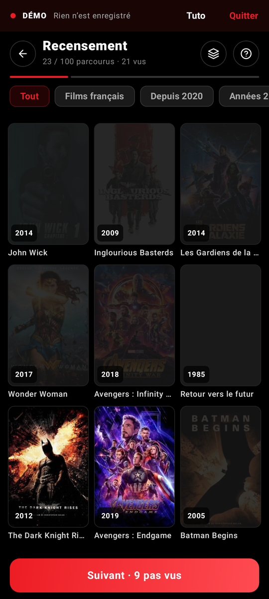
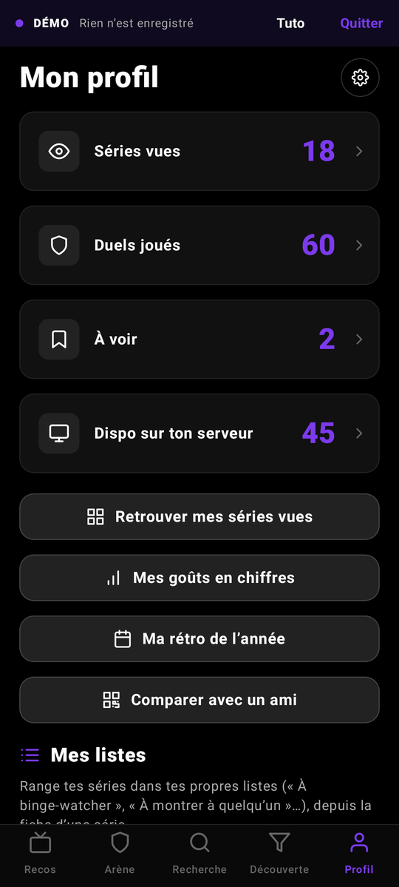
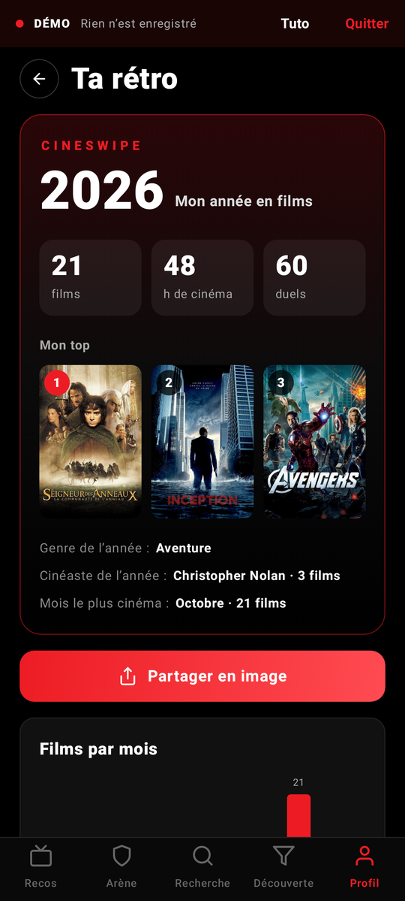

# CineSwipe

**Tes films et séries vus, ton classement à toi, et quoi regarder ce soir. Avec ton homelab si tu en as un.**

CineSwipe est une appli Android pour retrouver tout ce que tu as vu, le classer en duels
(« celui-ci ou celui-là ? ») jusqu'à obtenir un vrai classement personnel, et découvrir des films
et des séries faits pour toi. Films et séries vivent dans deux mondes séparés, chacun avec ses
recos, son Arène et sa bibliothèque ; pour les séries, tu sais toujours où tu en es.

Tout reste sur le téléphone : pas de compte, pas de serveur CineSwipe, pas de publicité ni de
statistiques d'usage. Rien à configurer : installe, et c'est parti.

<p align="center">
  <a href="https://github.com/DeedG/Cineswipe/releases/latest"><b>⬇ Télécharger la dernière version (APK)</b></a>
</p>

<p align="center">
  
  
  
  
  
  
</p>

---

## Sommaire

- [Installer](#installer)
- [L'idée](#lidée)
- [Fonctionnalités](#fonctionnalités)
- [Mode séries](#mode-séries)
- [Entre amis](#entre-amis)
- [Avec un homelab](#avec-un-homelab)
- [Premiers pas](#premiers-pas)
- [Données et vie privée](#données-et-vie-privée)
- [Téléphones compatibles](#téléphones-compatibles)
- [Pour les développeurs](#pour-les-développeurs)
- [Licence](#licence)
- [Crédits](#crédits)

## Installer

CineSwipe se télécharge ici, sur GitHub (pas de Play Store) :

1. Sur le téléphone, ouvre la [dernière version](https://github.com/DeedG/Cineswipe/releases/latest)
   et télécharge le fichier `CineSwipe-x.y.z.apk`.
2. Ouvre le fichier ; la première fois, Android demande d'autoriser l'installation depuis le
   navigateur.
3. C'est tout : la clé TMDB est intégrée, il n'y a rien à configurer.

**Mises à jour** : CineSwipe regarde chaque jour s'il y a une nouvelle version et te le dit (bandeau
sur le profil, Réglages › Mises à jour). Elle s'installe par-dessus, sans perdre tes données (même
signature). [Obtainium](https://github.com/ImranR98/Obtainium) peut aussi suivre ce dépôt.

Le fichier `.aab` publié à côté de l'APK ne sert qu'aux stores ; sur un téléphone, prends l'APK.

Android 8.0 ou plus récent.

## L'idée

1. **Retrouver ce qu'on a vu** en quelques minutes : le recensement fait défiler les films (ou
   les séries) que tu as le plus de chances d'avoir vus, 9 affiches par page, un toucher par titre.
2. **Les classer en duels** dans l'Arène : deux titres, tu touches celui que tu préfères. Le
   classement se recalcule à chaque duel et donne des étoiles à chacun, de ½ à 5.
3. **Découvrir** : les recos apprennent de ton classement et de tes swipes ; « Ce soir »
   propose quoi regarder parmi ta liste, ce qui est sur ton serveur et tes séries en cours.

Tant que l'appli te connaît peu (peu de titres vus, peu de duels), les recos te le disent et te
proposent de recenser ou de jouer quelques duels — une fois, sans insister.

## Fonctionnalités

### Recos

- Une carte plein écran par titre : affiche, raison de la proposition (« Parce que tu as aimé
  Drive », « Un film de Denis Villeneuve », « Pépite méconnue »…), réalisateur ou créateurs,
  note TMDB, acteurs, synopsis, bande-annonce, genres.
- **Swipe à gauche** : déjà vu. **Swipe à droite** : à voir (ou **demander** au serveur avec
  Seerr, Radarr ou Sonarr). **Vers le haut** : passer. **Pas pour moi** : écarter pour de bon.
  **Annuler** reprend les trois dernières actions.
- **⚡ Éclair** : une suite de recos à partir d'un titre.
- Le moteur combine le graphe des recommandations TMDB autour de tes titres (aimés, détestés,
  à voir), ton profil de goût (genres, réalisateurs, acteurs, thèmes, décennies, langues) et la
  qualité des œuvres. Il varie ses sources (pour toi, grands classiques, pépites, tendances, tes
  réalisateurs et acteurs, tes thèmes) selon ce que tu gardes ou écartes.

### Arène

- Duel entre deux titres vus : touche ton préféré, ou **Égalité**. **Annuler**, **Passer**,
  fiche détaillée de chacun.
- Classement **Bradley-Terry** (la même échelle que l'Elo), recalculé sur tout l'historique à
  chaque duel : l'ordre des duels ne compte pas, une égalité vaut un demi-point.
- Les duels proposés sont ceux qui apprennent le plus : des titres de niveau proche, en
  priorité ceux dont la place est encore incertaine.
- **Étoiles par rang** et **fiabilité** du classement affichée en direct : vers 90 %, le
  classement est solide.
- **Placement** : un titre que tu viens de voir joue 3 duels de suite pour trouver sa place.

### Recensement

- Pour retrouver vite tout ce que tu as déjà vu, sans fausser les recos.
- **Grille de 9 affiches** : un toucher = vu, deux = adoré, trois = bof (pour les séries : finie,
  en cours, par épisodes, décrochée) ; appui long = à voir, pas pour moi, fiche.
- Ou **en cartes**, avec les mêmes gestes que les recos.
- L'ordre apprend de tes réponses ; un film vu amène sa saga et ses films proches.

### Recherche, Découverte, Ce soir

- **Recherche** en cartes swipables, et des **acteurs, réalisateurs et créateurs** dès qu'on tape
  un nom.
- **Découverte** : genre, période, note minimale, durée (d'un film ou d'un épisode), « dispo sur
  mon serveur ».
- **Ce soir** : tes séries en cours d'abord (« À reprendre », saison suivante d'un toucher), puis ta
  liste et ton serveur, triés selon tes goûts. Boutons **Plex** et **Jellyfin**, ou **où le
  regarder** (abonnement, location, achat dans ton pays).

### Fiches

- Synopsis, durée, note TMDB, ton Elo et tes étoiles, bande-annonce, genres ; pour une série :
  saisons, durée d'un épisode, statut de diffusion, où tu en es.
- Fiches de la bibliothèque parcourues d'un **swipe gauche / droite**.
- Réalisateur et acteurs cliquables : leur filmographie, avec ce que tu as vu et tes étoiles.

### Profil

- Compteurs qui ouvrent la bibliothèque filtrée ; **bibliothèque** avec recherche et tris.
- **Mes goûts en chiffres** (heures passées, genres, réalisateurs ou créateurs, acteurs,
  décennies, langues, thèmes, titres « à contre-courant ») ; pour les séries : épisodes vus,
  finies, en cours, décrochées.
- **Ma rétro de l'année**, à partager en image ; **mes listes** ; **Hall of Fame**.

### Widgets

- **Ce soir**, **Mes stats**, **Mon top** : chacun en films ou en séries, configurable.

### Importer, sauvegarder, partager

- **Import** depuis **Letterboxd**, **Trakt**, **IMDb**, un **CSV** ou une sauvegarde CineSwipe ;
  pour les séries : Trakt (avec l'avancement), IMDb, CSV.
- **Sauvegarde automatique** chaque semaine (films et séries dans la même archive) dans le dossier
  de ton choix, et export JSON à la demande.
- **Partager vers CineSwipe** un lien TMDB, IMDb, Letterboxd, SensCritique, JustWatch, Trakt, ou
  simplement « Titre (année) ».

### Démo

- **Tuto et démo** dans un bac à sable (les 100 films, ou les 100 séries, les plus vus, un profil
  fictif, un homelab fictif) : rien n'est enregistré. « Montre-moi » fait le geste à ta place.

## Mode séries

Un switch **Films | Séries** (en haut des écrans, ou un appui long sur l'icône) fait passer toute
l'appli dans le monde des séries, en violet. Rien n'est partagé avec les films.

- **Où tu en es** : en cours (avec la saison, ou « je ne sais plus »), finie, vue par épisodes
  (au hasard, à la télé), décrochée. Au swipe, au recensement ou sur la fiche.
- **Nouvelles saisons** : une notification quand une série vue a une nouvelle saison (sortie,
  ou annoncée dans le mois), avec « Remettre en cours » et « Demander la saison ».
- **Arène des saisons** : les saisons que tu as vues s'affrontent entre elles et ont leur propre
  classement, à part des séries (bouton en haut de l'Arène, en mode séries).
- **Demandes saison par saison** à Seerr ou Sonarr : toute la série, ou quelques saisons.
- **Plex et Jellyfin** savent où tu en es : une série commencée sur ton serveur passe « en cours »
  sur la bonne saison, une série terminée passe « finie ».

## Entre amis

Profil › **Comparer avec un ami** : chacun montre son **QR code**, l'autre le scanne (ou reçoit le
code par message). CineSwipe calcule votre **compatibilité** et propose ce qu'il y a **à voir
ensemble**, ce que ton ami a adoré et que tu n'as pas vu, ce que tu peux lui conseiller, vos coups
de cœur communs et vos plus gros désaccords. Tout se passe sur les téléphones, rien ne passe par
Internet.

## Avec un homelab

Tout est optionnel et chaque service est indépendant. Réglages › Homelab :

| Service | Ce qu'il apporte |
|---|---|
| **Plex** | Films et séries vus (synchronisés, avec l'avancement des séries), disponibles (badge « Sur le serveur »), bouton « Plex ». Compte Plex ou jeton ; pas besoin de Plex Pass. |
| **Jellyfin** | Pareil : vus, disponibles, bouton « Jellyfin ». Clé API ou identifiant et mot de passe. |
| **Seerr** (Overseerr, Jellyseerr) | Le swipe à droite **demande** le film ou la série (toute la série ou certaines saisons). |
| **Radarr** | Demandes directes de films : profil de qualité, dossier, recherche à l'ajout. |
| **Sonarr** | Demandes directes de séries, saisons choisies seulement surveillées. |

- **Adresse au choix**, port compris : IP Tailscale, IP locale, nom de domaine, chemin de
  reverse proxy. En-têtes supplémentaires possibles (Cloudflare Access…). « Tester la connexion ».
- **Synchro** à l'ouverture, toutes les 6 h et à la demande. Une synchro ne retire jamais un titre
  des vus, et l'avancement d'une série ne recule jamais.
- **Après un film vu, ou une série commencée ou finie** sur ton serveur, une notification propose
  de la placer dans ton classement.
- **Hors ligne** : les demandes attendent dans une file et partent dès que le serveur répond.

## Premiers pas

1. **Essaie la démo** depuis l'accueil (ou passe directement à la suite).
2. **Retrouve ce que tu as vu** : importe (Letterboxd, Trakt, IMDb, CSV) et/ou fais un tour de
   recensement.
3. **Joue quelques duels** dans l'Arène : vers 8 duels par titre, le classement est fiable.
4. Si tu as un homelab, connecte tes services dans Réglages › Homelab.

Tu peux mettre **ta propre clé TMDB** (Réglages › Clé API TMDB) : elle remplace celle de l'appli.

## Données et vie privée

- Tes films, séries, duels, listes et réglages sont **sur le téléphone**, et dans les sauvegardes
  que tu choisis de faire.
- Les clés de tes services sont **chiffrées** avec l'Android Keystore et exclues des sauvegardes.
- L'appli ne contacte que **TMDB** (fiches, affiches), **tes serveurs**, plex.tv si tu utilises
  Plex, et l'API de **GitHub** une fois par jour pour savoir s'il y a une nouvelle version.
- La caméra ne sert qu'à scanner le QR code d'un ami.
- Détails : [politique de confidentialité](docs/confidentialite.md).

## Téléphones compatibles

- Tout téléphone Android 8.0+, en portrait. Icône à thème sur Android 13+.
- En français, ou en anglais si le téléphone est en anglais.
- **Pliants** : écran externe et écran intérieur. Sur un grand écran (pliant ouvert, tablette,
  multi-fenêtre), l'appli garde sa mise en page de téléphone, centrée.

## Pour les développeurs

### Technique

- **Kotlin** 2.3, **Jetpack Compose** (Material 3), **Navigation 3**, **Room** (KSP, schémas
  versionnés et migrations automatiques), DataStore, **Retrofit** / OkHttp, kotlinx.serialization,
  Coil 3, **WorkManager**, **Glance** (widgets), **CameraX** et **ZXing** (QR codes). Injection de
  dépendances à la main (`AppContainer`, un par monde : films et séries).
- `minSdk 26`, `targetSdk 36`.

```
app/src/main/java/io/github/deedg/cineswipe/
├── domain/        Classement (Bradley-Terry, incertitudes, étoiles), appariement, moteur des recos,
│                  recensement, temps passé, nouvelles saisons, codes de goûts : Kotlin pur, testé
├── data/
│   ├── db/        Room : movie (cache TMDB), user_movie, duel, listes, file des demandes, recos
│   ├── tmdb/      API TMDB, conversion vers le cache, adaptateur des séries
│   ├── homelab/   Plex, Jellyfin, Seerr, Radarr, Sonarr ; synchro, file d'attente, notifications
│   ├── importer/  Letterboxd, Trakt, IMDb, CSV, sauvegardes
│   ├── series/    Nouvelles saisons
│   ├── update/    Vérification des mises à jour (dépôt public)
│   ├── demo/      Catalogues de la démo, TMDB et homelab simulés
│   └── repository/
├── widget/        Widgets Glance
└── ui/            Écrans Compose, tuto de la démo
```

### Construire et tester

- `./gradlew testDebugUnitTest` : tests unitaires et parcours des écrans avec **Robolectric**,
  contre de faux serveurs (TMDB, Plex, Jellyfin, Seerr, Radarr, Sonarr).
- `./gradlew assembleDebug` : APK installable directement (sans clé TMDB intégrée : mets la tienne
  dans les réglages, ou exporte `TMDB_BUILTIN_KEY` avant de compiler).
- Chaque version de ce dépôt est compilée, testée et publiée dans les releases par GitHub Actions,
  signée avec la clé du projet et avec la clé TMDB intégrée (secrets du dépôt). Sur un fork sans
  ces secrets, la CI teste et compile seulement. Une version compilée par toi porte une autre
  signature : exporte une sauvegarde et désinstalle avant de passer de l'une à l'autre.
- Workflows manuels : **Captures** (tour de la démo photographié sur 6 tailles d'écran, films et
  séries) et **Classpath** (bibliothèques de compilation, pour vérifier les types hors de Gradle).

## Licence

CineSwipe est un logiciel libre, sous licence [GNU GPL v3](LICENSE) : tu peux l'utiliser, l'étudier,
le modifier et le redistribuer, à condition que les versions modifiées restent sous la même
licence, avec leur code source.

## Crédits

Données et images : [TMDB](https://www.themoviedb.org). Ce produit utilise l'API TMDB mais n'est
ni approuvé ni certifié par TMDB. Offres de streaming : JustWatch, via TMDB.

Plex, Jellyfin, Seerr, Radarr, Sonarr, Letterboxd, Trakt et IMDb sont des marques de leurs
propriétaires respectifs ; CineSwipe n'est affilié à aucun d'eux.
